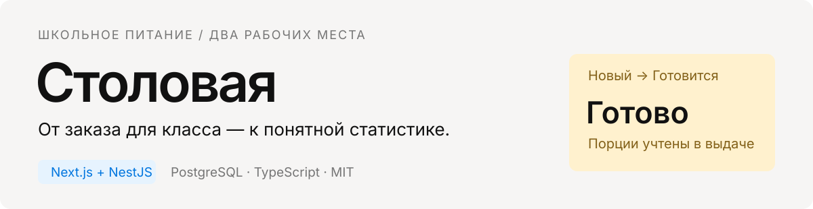
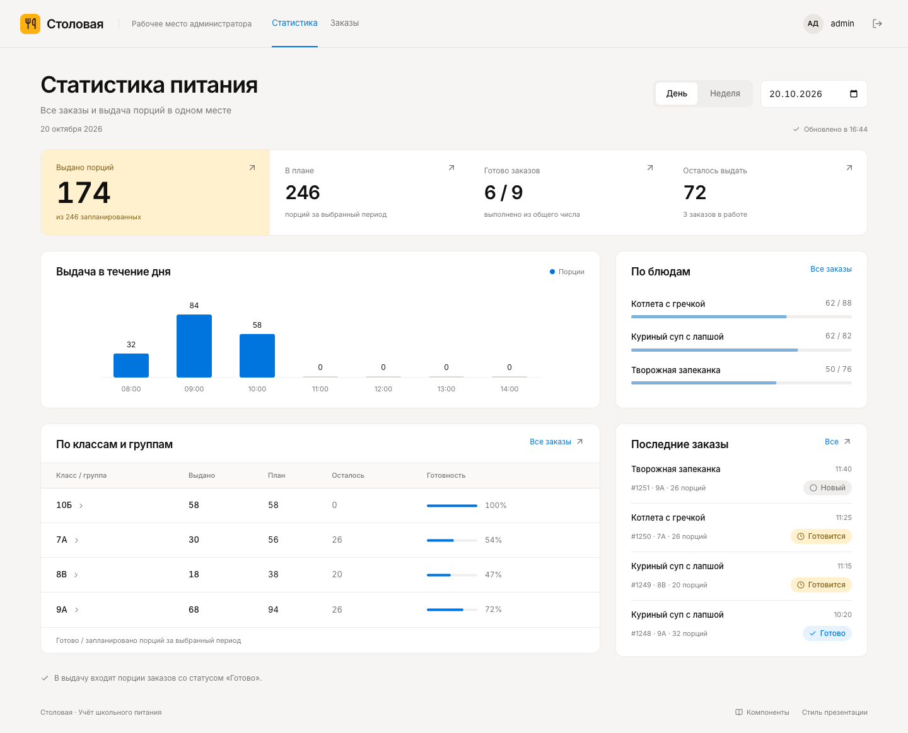
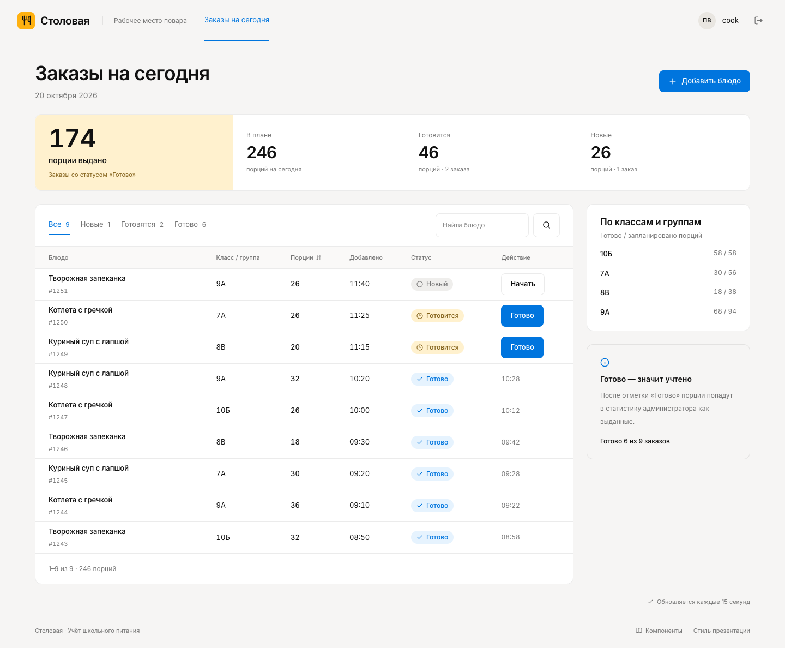
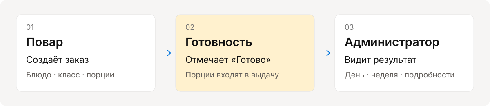
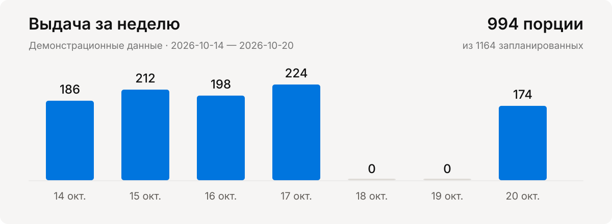
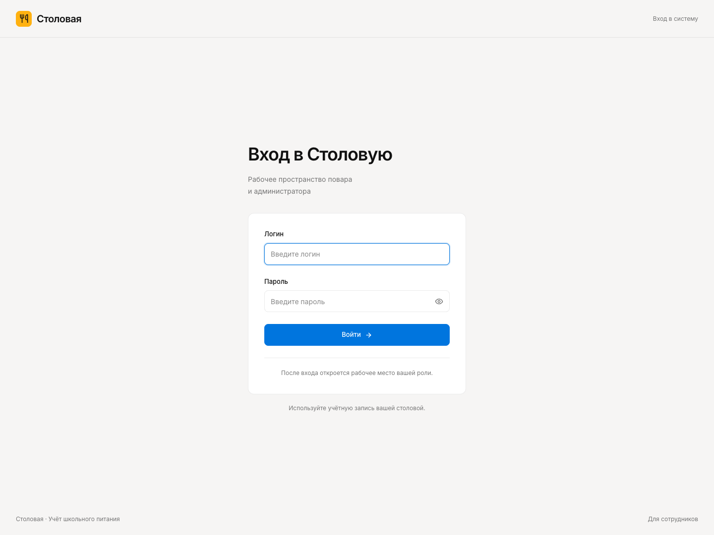
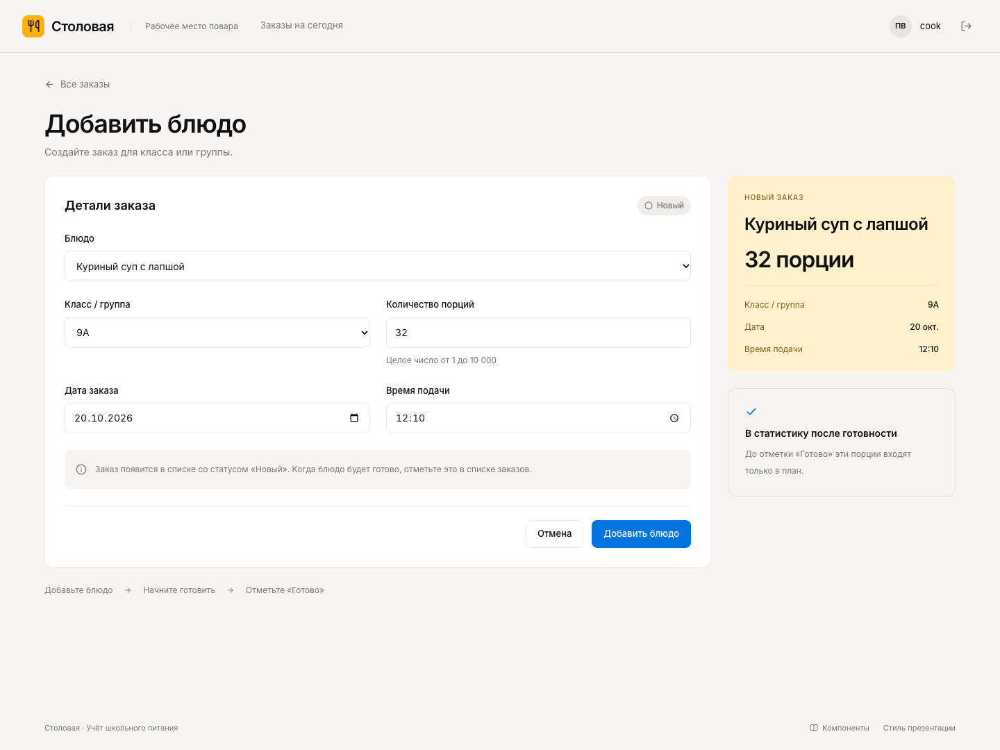
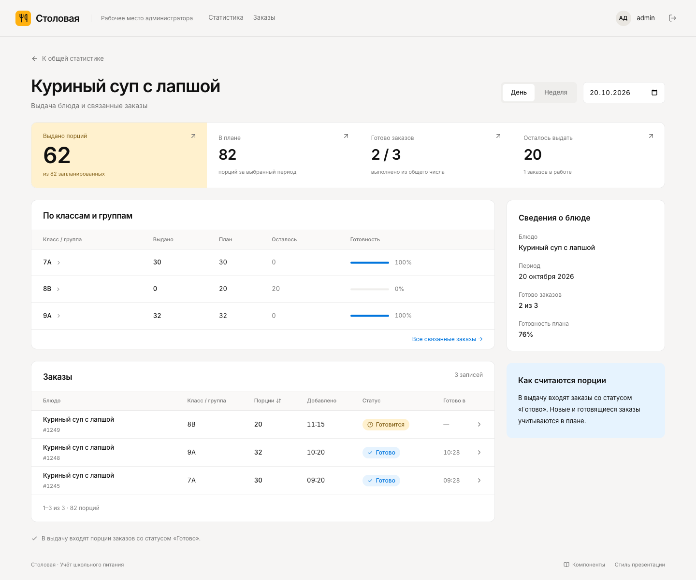
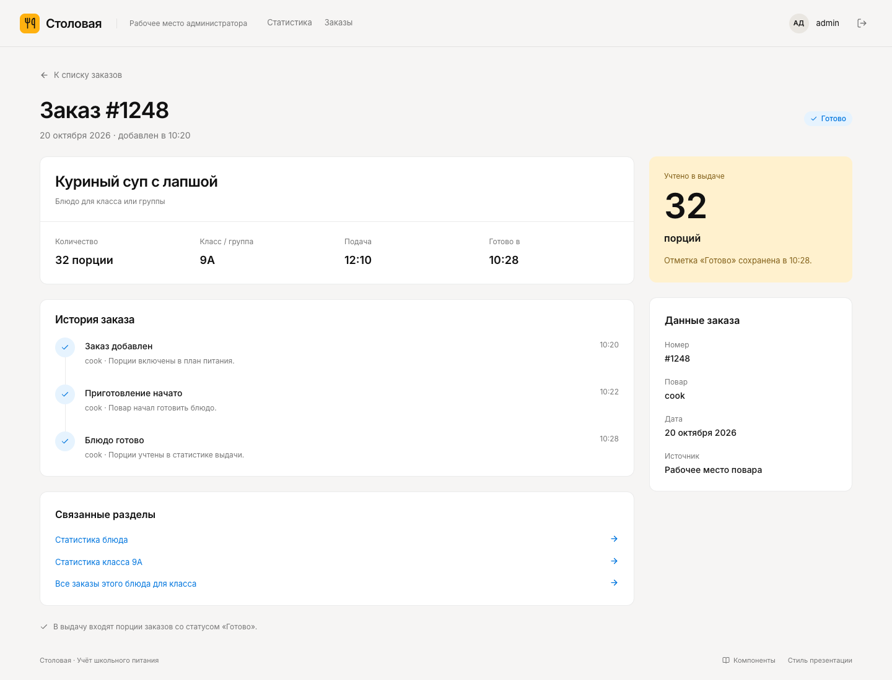
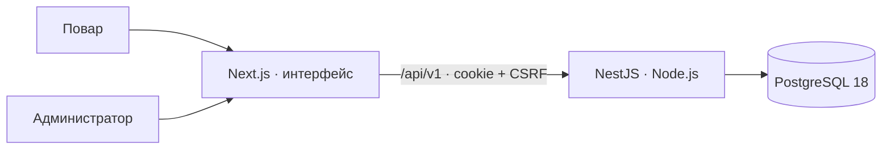

<p align="center">
  
</p>

Повар добавляет блюда для классов и групп, отмечает приготовление и готовность. Администратор видит, сколько порций запланировано и выдано, и открывает подробности каждого показателя.

[Быстрый запуск](#быстрый-запуск) · [Все экраны](docs/SCREENS.md) · [Архитектура](docs/ARCHITECTURE.md) · [Настройка](docs/SETUP.md) · [API](docs/API.md)

## Администратор: от общей картины к заказу



Карточки показателей, столбцы графика, блюда и классы открывают связанные заказы. Доступны день и неделя, поиск, фильтры по статусу, блюду и классу, сортировка и пагинация. Открытые данные обновляются каждые 15 секунд и при возвращении в окно.

## Повар: добавить, приготовить, отметить готовность



Заказ содержит блюдо, класс или группу, число порций, дату и время подачи. **Новый → Готовится → Готово.** Только статус «Готово» включает порции в выдачу. Повторное подтверждение не увеличивает показатели.

<p align="center">
  
</p>

## Графики на данных приложения

<p align="center">
  
</p>

Все скриншоты сняты с работающего приложения. На них **демонстрационные данные**, загруженные в PostgreSQL: за день — **174 / 246** порций и **6 / 9** готовых заказов; за неделю — **994 / 1164** порций и **35 / 44** готовых заказов. [Исходные значения графика](assets/readme/demo-analytics.json).

<details>
<summary>Вход, создание заказа и подробная аналитика</summary>

### Вход



### Новый заказ



### Аналитика блюда



### История заказа



</details>

## Быстрый запуск

Нужен запущенный Docker с Docker Compose v2+. Для разработки без контейнеров приложений — Node.js 24.

```bash
git clone https://github.com/Hqzdev/stolovaya.git
cd stolovaya
cp .env.example .env
```

Заполните `.env`: два логина, два пароля не короче 8 символов и случайный `SESSION_SECRET` не короче 32 символов. Для генерации секрета: `openssl rand -hex 32`. Настройте пароль PostgreSQL и такую же строку подключения в `DATABASE_URL`.

```bash
docker compose up -d --build --wait
docker compose exec api npm run db:catalog
```

Откройте **[localhost:3000](http://localhost:3000)** и войдите одним из аккаунтов из `.env`. Миграции применяются автоматически. Команда `db:catalog` добавляет три блюда и четыре класса из макетов; существующие записи сохраняются.

Для демонстрации, **только в пустой базе заказов**:

```bash
docker compose exec api npm run db:demo
```

Набор привязан к текущей дате столовой. Можно задать дату явно: `docker compose exec -e DEMO_DATE=2026-10-20 api npm run db:demo`. Команда откажется менять базу, в которой уже есть заказы.

## Ровно две учётные записи

| Роль          | Логин         | Пароль           | Доступ                                   |
| ------------- | ------------- | ---------------- | ---------------------------------------- |
| Администратор | `ADMIN_LOGIN` | `ADMIN_PASSWORD` | Статистика, подробная аналитика, история |
| Повар         | `COOK_LOGIN`  | `COOK_PASSWORD`  | Создание заказов и изменение статусов    |

Значения хранятся в `.env` на сервере. Регистрации, создания других аккаунтов и переключателя роли нет. Сессия живёт 8 часов; при смене учётных данных и перезапуске API прежние сессии этой роли перестают действовать. Настоящий `.env` исключён из Git.

## Стек и устройство



| Слой      | Реализация                                                      |
| --------- | --------------------------------------------------------------- |
| Интерфейс | Next.js 16, React, TypeScript, Tailwind CSS 4, локальный Inter  |
| Сервер    | NestJS 12, Node.js 24, валидация DTO, OpenAPI                   |
| Данные    | PostgreSQL 18, `pg`, SQL-миграции, транзакции                   |
| Доступ    | Два аккаунта из окружения, HttpOnly-cookie, CSRF, проверка роли |
| Запуск    | Docker Compose: web + api + database, постоянный том            |

На сервере контроллеры принимают запросы, сервисы выполняют правила, репозитории обращаются к БД. Общие TypeScript-интерфейсы лежат в `packages/contracts`. Порции хранятся в заказах; агрегаты вычисляются SQL-запросами.

## Разработка и проверки

```bash
npm ci
docker compose up -d database
npm run db:catalog
npm run dev
```

Если приложение уже запущено целиком в Docker, сначала освободите порт: `docker compose stop web api`.

```bash
npm run lint
npm run typecheck
npm run build
npm run verify
```

Проверка API создаёт один заказ на 3 порции и удаляет его после проверки. Используйте отдельную локальную базу. `VERIFY_DEMO=true npm run verify` дополнительно проверяет контрольные значения демонстрационного набора. Браузерные сценарии и воспроизведение скриншотов описаны в [инструкции запуска](docs/SETUP.md#проверки-и-скриншоты).

## Документация

- [Экраны и сценарии](docs/SCREENS.md)
- [Запуск, переменные окружения, резервное копирование](docs/SETUP.md)
- [Архитектура и модель данных](docs/ARCHITECTURE.md)
- [API и правила доступа](docs/API.md)
- [Как вносить изменения](CONTRIBUTING.md)
- [Безопасность](SECURITY.md) · [История изменений](CHANGELOG.md)

## Лицензия

[MIT](LICENSE) © 2026 Hqzdev.
