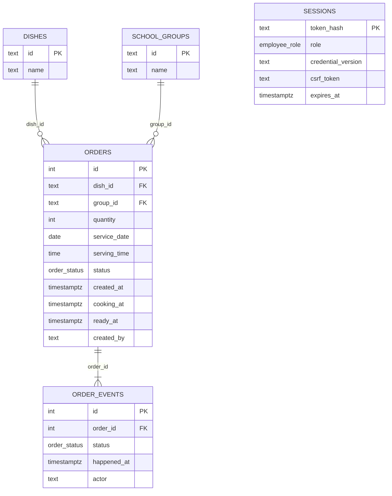

# Архитектура

## Поток данных

Браузер → Next.js `/api/v1/*` → NestJS → PostgreSQL. Прокси передаёт только необходимые cookie, `Origin`, тип содержимого и CSRF-заголовок. Ответы API не кэшируются. Пароли не передаются в клиентскую конфигурацию.

NestJS проверяет ограничение запросов, сессию, роль, origin и CSRF. DTO валидируют форму входа, заказ и параметры фильтрации. Контроллер передаёт задачу сервису, репозиторий выполняет параметризованный SQL.

## Модули

| Часть                          | Ответственность                                              |
| ------------------------------ | ------------------------------------------------------------ |
| Environment                    | Валидация окружения, две учётные записи, дата и часовой пояс |
| CredentialsService             | Проверка пароля и версия учётных данных                      |
| AuthService / AccessGuard      | Сессии, CSRF и разграничение прав                            |
| CatalogService                 | Справочники и проверка ссылок заказа                         |
| OrderService / OrderRepository | Создание, поиск, история и переходы статуса                  |
| ScopeService                   | Границы дня и семидневного периода                           |
| AnalyticsService               | SQL-агрегаты, разбивка, графики и подробности                |
| Database                       | Пул соединений, транзакции и миграции                        |

Фронтенд использует отдельный HTTP-клиент, контекст входа и хук загрузки с отменой устаревших запросов. Повторяются компоненты кнопок, полей, статусов, таблиц, метрик и графиков. Состояние аналитики находится в URL, поэтому переходы и история браузера восстанавливают выбранный контекст.

## Модель данных

Таблицы пользователей нет: существуют только два аккаунта из окружения. Имя автора заказа сохраняется снимком логина. Смена логина не переписывает историю.

## Инварианты учёта

- Заказ относится к одному блюду и одному классу/группе. Количество — целое от 1 до 10 000.
- `new → cooking → ready`. Обратные переходы и пропуск приготовления возвращают 409.
- Смена статуса использует `SELECT … FOR UPDATE`; статус, время и событие фиксируются в одной транзакции. Повтор текущего статуса возвращает существующий результат.
- Один статус создаёт не более одного события на заказ: это ограничено уникальным ключом БД.
- План — `sum(quantity)`, выдача — `sum(quantity) FILTER (WHERE status = 'ready')`. Отдельного счётчика выдачи нет.
- День и неделя отбираются по `service_date`; неделя включает выбранный день и шесть предыдущих.
- Почасовой график использует локальный час `ready_at` для заказов выбранной даты. История содержит реальные абсолютные времена. Готовность после полуночи остаётся в периоде даты заказа.
- `serving_time` — плановое время подачи, оно не заменяет фактические времена событий.

Открытая аналитика и список заказов обновляются каждые 15 секунд при видимом документе и при возвращении фокуса. После изменения статуса кабинет повара перечитывает данные сразу.

## Миграции и эксплуатация

Миграции SQL применяются в порядке имён файлов. Advisory lock защищает запуск нескольких процессов. Каждая миграция выполняется в транзакции и отмечается в `schema_migrations`. При ошибке API не начинает принимать запросы.

Compose использует постоянный том PostgreSQL. API и web запускаются после готовности зависимостей, имеют проверки здоровья и политику перезапуска. Для локальной версии не нужны Redis, внешняя авторизация или облачный сервис БД.
