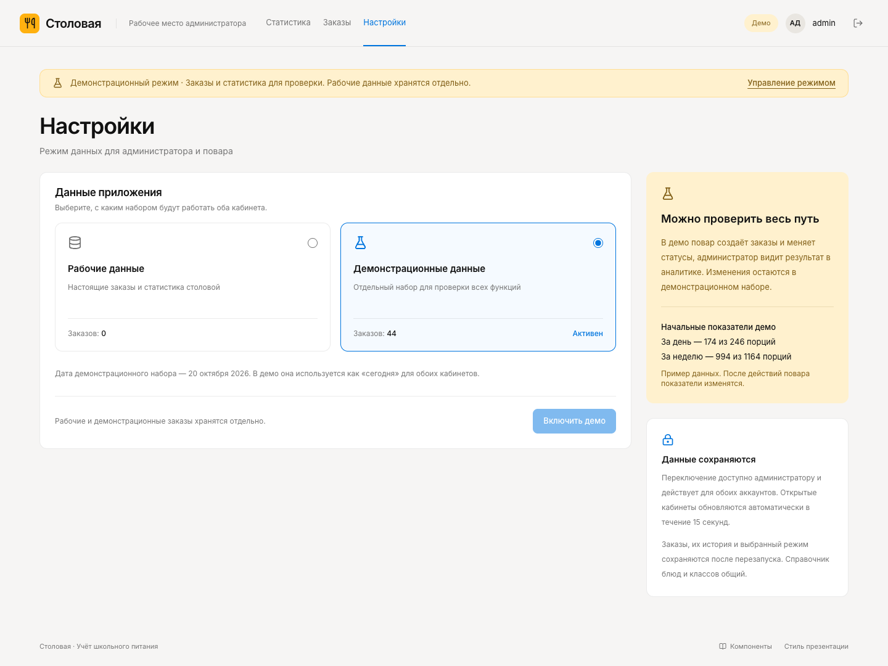
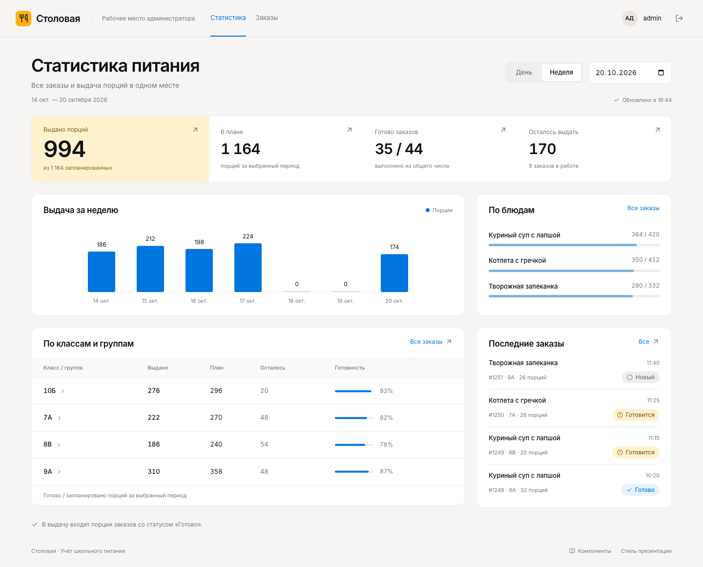
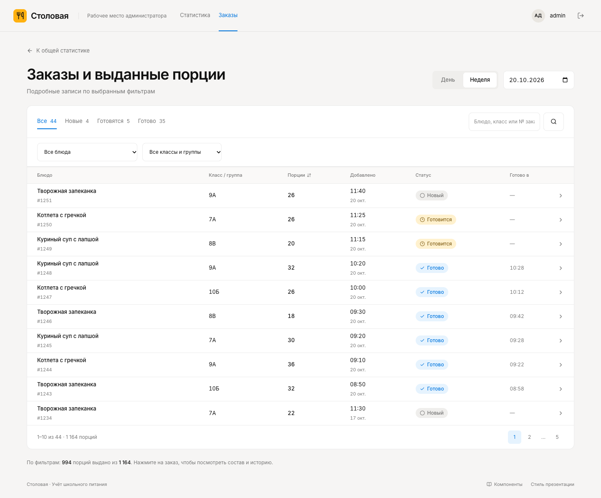
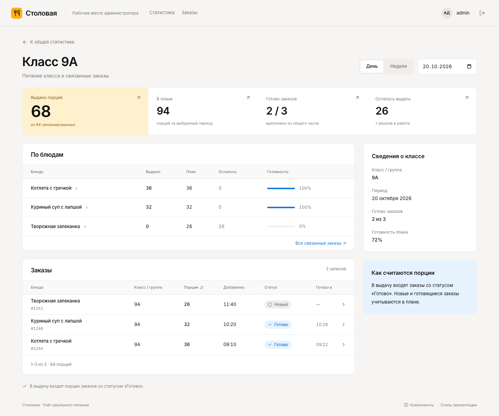
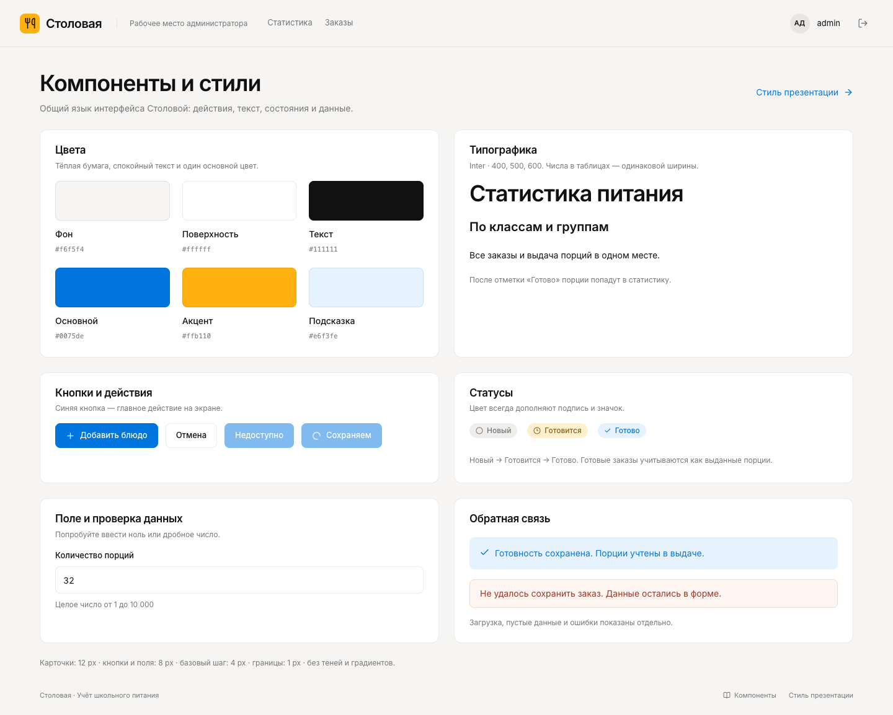
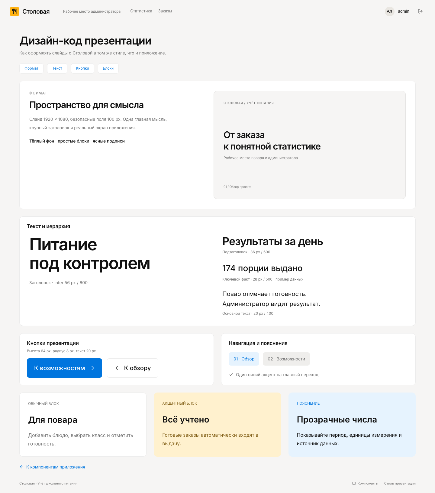

# Экраны приложения

Основной размер — настольный браузер 1440 × 1080. Источник визуального стиля — [макеты Pencil](../verify.pen). Скриншоты ниже сняты с работающей версии, данные демонстрационные.

| Экран             | Адрес                 | Сценарий                                        |
| ----------------- | --------------------- | ----------------------------------------------- |
| Вход              | `/login`              | Логин и пароль без выбора роли                  |
| Заказы повара     | `/cook`               | Текущий день, поиск, статусы и действия         |
| Добавление блюда  | `/cook/orders/new`    | Создать заказ для класса или группы             |
| Статистика        | `/admin`              | День/неделя, показатели и кликабельный график   |
| Заказы            | `/admin/orders`       | Поиск, фильтры, сортировка и страницы           |
| Блюдо             | `/admin/dishes/:id`   | Выдача блюда и связанные классы                 |
| Класс             | `/admin/groups/:id`   | Питание класса и связанные блюда                |
| Заказ             | `/admin/orders/:id`   | Состав, время подачи и история                  |
| Настройки         | `/admin/settings`     | Общий режим рабочих или демонстрационных данных |
| Компоненты        | `/components`         | Кнопки, поля, цвета и состояния                 |
| Стиль презентации | `/presentation-style` | Типографика, блоки и кнопки слайдов             |

Повар также может открыть подробности своего рабочего списка по `/cook/orders/:id`. Страницы материалов доступны обеим ролям через ссылки внизу интерфейса.

## Настройки данных

## Неделя

## Список заказов

## Аналитика класса

## Компоненты

## Стиль презентации

## Состояния

- Загрузка — отдельное сообщение с индикатором, без ложных нулей.
- Пустой день — объяснение и действие добавления в кабинете повара.
- Пустой поиск — сообщение с возможностью сбросить фильтры.
- Ошибка формы — данные остаются заполненными.
- Сохранённая готовность — подтверждение и обновлённые показатели.
- Истёкшая сессия — возврат на страницу входа.
